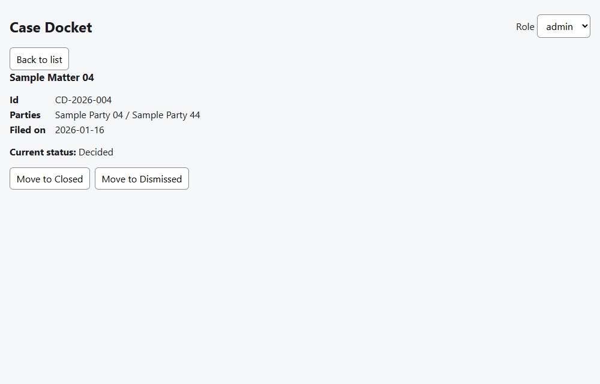
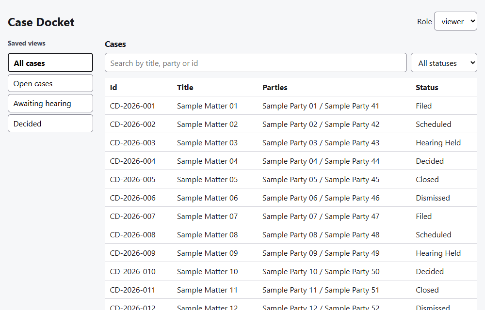
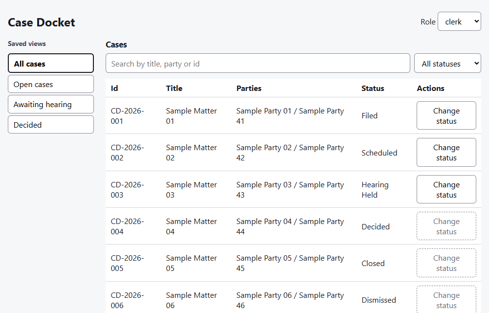

# Case Docket Dashboard

A small web app for browsing a fictional court docket and moving cases through a status workflow. It is a portfolio project: React, TypeScript, tests, CI, Docker and GitHub Pages. All data is made up (parties are labelled "Sample Party NN").

Live site: https://ryan-dmg.github.io/Case-Docket-Test/



## What it does

- **Case list:** 40 fictional cases with text search (id, title, parties) and a status filter.
- **Saved views:** All cases, Open cases, Awaiting hearing, Decided.
- **Roles:** a role switcher with `viewer`, `clerk` and `admin`. The role decides what is visible and which actions are enabled.
- **Case detail and status workflow:** only the transitions the current role may make are offered.

| Viewer | Clerk |
|---|---|
|  |  |

## Business rules

Statuses: `Filed`, `Scheduled`, `Hearing Held`, `Decided`, `Closed`, `Dismissed`. "Open" means any status except `Closed` and `Dismissed`.

| Transition | viewer | clerk | admin |
|---|---|---|---|
| Filed to Scheduled | no | yes | yes |
| Scheduled to Hearing Held | no | yes | yes |
| Hearing Held to Decided | no | yes | yes |
| Decided to Closed | no | no | yes |
| Any open status to Dismissed | no | no | yes |
| Closed to Decided (reopen) | no | no | yes |

Any transition not in the table is rejected for every role. The rules live in one module, `src/rules.ts`, and the UI reads only from it.

## Run it

Requires Node 24 (see `.nvmrc`).

```bash
npm ci
npm run dev
```

Open the address Vite prints (by default http://localhost:5173).

## Test, lint and type check

```bash
npm test          # Vitest and Testing Library, runs once and exits
npm run lint      # ESLint
npm run typecheck # TypeScript
npm run build     # type check and production build into dist/
```

The tests cover the data, every cell of the rules table, the case list, role permissions and the status-change workflow. Rules tests were written before the code.

## Run it in Docker

```bash
docker build -t case-docket .
docker run -p 8080:80 case-docket
```

Open http://localhost:8080. The image is built in two stages: Node builds the static site, then nginx serves only the built files.

## CI and deployment

- `.github/workflows/ci.yml` runs install, lint, type check, tests and build on every push and pull request.
- `.github/workflows/deploy.yml` builds the site and publishes it to GitHub Pages when `main` changes. The build sets the base path from the repository name through `VITE_BASE`; local development and Docker use `/`.

## Keyboard use

Every control is a native form control or button, so the whole app works from the keyboard.

1. Press Tab: focus goes first to the Role select. Use the arrow keys to pick a role.
2. Tab on to the saved views (Enter or Space applies one), then the search box and the status filter.
3. Tab through the table to the "Change status" buttons (clerk and admin only; disabled buttons are skipped).
4. Press Enter on a button to open the case. Tab to a "Move to ..." button and press Enter to change the status.
5. Tab back to "Back to list" and press Enter. Search and filter text are kept.

Focus is always outlined, status is always written out as text, and disabled buttons are marked by a dashed border as well as grey text, so nothing depends on color alone.

## Notes

- Status changes live in memory. Reloading the page resets the data.
- Project layout: `src/types.ts` (types), `src/data/` (fictional cases), `src/rules.ts` (workflow rules), `src/components/` (list and detail views), `src/App.tsx` (role and case state).
